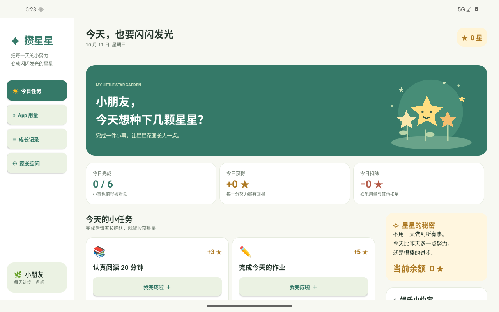

# 攒星星 · Star Collect

给安卓平板上的小朋友记录每天的小努力，把任务奖励与娱乐 App 用量放进同一本星星账本。原生 Android MVP，中文界面，横屏平板双栏布局，也支持竖屏和手机。



## 首版功能

- **今日任务**：预置阅读、作业、运动、整理等任务。孩子提交完成，家长确认后加星；每项任务每天领取一次。
- **家长空间**：首次设置 4–8 位数字 PIN；自定义任务和奖励、修改昵称、确认或退回任务、撤销记录、按原因补奖或扣星。退出应用或 5 分钟后锁定。
- **App 用量**：从本机已安装、带启动入口的 App 中选择统计对象。每个 App 独立设置每日免费分钟、计费分钟、每次扣星数量；默认每累计 10 分钟扣 1 星。
- **成长记录**：按日期查看做过的事情、星星收支、App 用量，以及最近 7 天获得的星星。
- **本机保存**：无账号，任务、用量和星星记录只保存在本机；可通过系统文件选择器导出 JSON 留档，导出不包含 PIN 凭据。首版不支持导入。
- **手动更新**：家长主动检查 GitHub 正式 Release，经 139 服务器下载新版并确认覆盖安装。记录不会上传到更新服务器，应用不会自动检查或安装。

## 安装与首次使用

支持 Android 8.0（API 26）及以上。安装包见 [GitHub Release](https://github.com/string1225/star-collect/releases/latest)，或直接下载 [139 服务器上的 v0.1.1 APK](https://home.sunny-string.cn/github-release/string1225/star-collect/download/v0.1.1/star-collect.apk)。将 APK 传到平板，允许安装来自该文件来源的应用后安装。

1. 先由家长进入「家长空间」设置 PIN、昵称、任务与奖励。
2. 进入「App 用量」，点击「家长授权统计」，在系统的**使用情况访问权限**页面允许「攒星星」。返回后将从授权时开始计时。
3. 点击「添加 App」选择游戏、视频等 App，并配置规则。
4. 孩子完成任务后点「我完成啦」，家长进入家长空间确认奖励。

**例子**：每天免费 5 分钟，之后每累计 10 分钟扣 2 星。当天累计 14 分 59 秒不扣星，15 分钟扣 2 星，25 分钟共扣 4 星。只按完整计费单位扣星，零头当天累计，次日免费额度重新计算。

星星余额允许为负数，欠下的星星可以通过后续任务补回来。应用记录和结算娱乐用量，首版没有强制拦截或关闭其他 App 的功能。

## 用量与结算约定

- 使用 Android `UsageStatsManager.queryEvents` 读取前台活动事件，不统计纯后台音频等后台使用。多个前台 Activity 在同一个 App 内取时间并集；分屏时不同 App 可分别累计。
- 后台使用 `JobScheduler`，请求约每 15 分钟结算，重启后保留调度；系统省电、厂商后台限制可能延迟执行。应用打开时和停留期间每分钟也会同步，可手动刷新。
- 首次授权、新增规则均从当前时刻开始，不追扣之前的用量。拒绝或撤销权限时不扣星；再次授权后重新开始统计。
- 修改或停用规则时先同步旧用量。新规则从保存时重新累计，免费额度重新计算；旧规则及其扣星记录保留，重复刷新不会重复扣星。
- 跨天使用按自然日拆分。采用首次安装时设备的时区作为账本时区，修改设备时区不会移动已有账目。
- 系统事件只保留有限天数，因此只尝试补算最近 48 小时。超出该窗口会明确显示统计缺口，不推测缺失用量。建议每天打开一次；被系统强制停止后需要重新打开。
- PIN 是应用内的家长操作门槛，无法防止孩子在 Android 系统设置里卸载、清除数据或撤销权限。没有忘记 PIN 的远程恢复功能，请妥善记住。
- 卸载或清除应用数据会删除本机记录。自动云备份和设备迁移已关闭，建议定期导出留档。

Android 权限及事件保留的依据见 [UsageStatsManager 官方文档](https://developer.android.com/reference/android/app/usage/UsageStatsManager)，活动事件语义见 [UsageEvents.Event](https://developer.android.com/reference/android/app/usage/UsageEvents.Event)，后台调度见 [JobInfo.Builder](https://developer.android.com/reference/android/app/job/JobInfo.Builder)。

## 手动更新与服务器

进入「家长空间」→「检查应用更新」→「检查更新」。有新版本时显示版本说明，点击「下载新版」，下载完成后点击「安装新版」。首次更新需在系统页面允许「攒星星」安装应用，返回后输入家长 PIN，再次点击安装，由 Android 显示最终安装确认。覆盖安装保留任务、账本、统计规则和 PIN。

应用优先使用 `https://home.sunny-string.cn/github-release/string1225/star-collect/latest`，该服务部署在 `139.224.12.141`；服务器不可用时尝试 GitHub 官方 API 和下载链接。只接受正式版本标签 `vX.Y.Z` 和附件 `star-collect.apk`，拒绝草稿和预发布。下载须通过大小、SHA-256、包名、递增 versionCode、版本名称、最低系统版本和当前签名证书校验。

服务器使用 Python 标准库服务和 nginx，GitHub 元数据缓存 60 秒，APK 校验后缓存到磁盘。路径只允许配置中的仓库，不能作为任意 URL 代理。部署文件位于 `server/` 和 `deploy/`；将两目录上传到 139 服务器后运行 `sh deploy/install.sh`，脚本备份现有配置、运行测试、检查 nginx 配置后重载。服务为 `github-release.service`，端口仅监听 `127.0.0.1:3043`，上游通过服务器现有 `127.0.0.1:7890` 代理访问 GitHub。健康检查路径为 `/github-release/health`。

## 构建与发布更新

发布必须沿用固定签名，否则不能覆盖已安装应用。当前固定签名文件保存在开发机的 `C:\Users\junte\.android\star-collect-release.keystore`，与已分发首版保持同一证书，不提交到仓库。配置以下环境变量，再构建正式包：

```powershell
$env:STAR_COLLECT_KEYSTORE='签名文件的绝对路径'
$env:STAR_COLLECT_STORE_PASSWORD='签名库密码'
$env:STAR_COLLECT_KEY_ALIAS='签名别名'
$env:STAR_COLLECT_KEY_PASSWORD='签名密钥密码'
.\gradlew.bat :app:assembleRelease :app:testDebugUnitTest :app:lintRelease
```

每次发布在 `app/build.gradle` 提高 versionCode 和 versionName；可使用 `-PappVersionCode=3`、`-PappVersionName=0.1.2` 参数。正式 APK 为 `app/build/outputs/apk/release/app-release.apk`，需用 SDK 的 `apksigner verify --print-certs` 验证签名。提交并推送后发布：

```powershell
python tools/publish_release.py --tag v0.1.1 --apk app/build/outputs/apk/release/app-release.apk --notes docs/release-v0.1.1.md
```

脚本使用 GitHub CLI `gh` 和现有 Git Credential Manager 凭据，或进程环境中的 `GH_TOKEN`；不输出或保存令牌。先上传 APK 和 `SHA256SUMS` 到草稿 Release，再公开发布为最新版本，避免客户端看到缺失附件的版本。

## 本地开发

项目采用 Java 17 语言级别、Android Gradle Plugin 9.3.0、Gradle 9.5.0、compile/target SDK 36。可直接用 Android Studio 打开仓库；无需业务框架或额外运行服务。

命令行构建需要 JDK 17+（Gradle 支持的版本）、Android SDK Platform 36 和 Build Tools 36.0.0。设置 `JAVA_HOME`，通过 `ANDROID_HOME` 或 Android Studio 生成的 `local.properties` 指定 SDK 路径。

```powershell
.\gradlew.bat :app:assembleDebug :app:testDebugUnitTest :app:lintDebug
```

macOS / Linux：

```sh
./gradlew :app:assembleDebug :app:testDebugUnitTest :app:lintDebug
```

测试 APK 使用专用 Instrumentation，没有第三方设备测试依赖。**仅在可清除数据的测试模拟器运行**：先安装主 APK 和测试 APK，清除该应用测试数据、设置模拟器为宽屏，再执行：

```powershell
.\gradlew.bat :app:assembleDebugAndroidTest
adb install -r app/build/outputs/apk/debug/app-debug.apk
adb install -r app/build/outputs/apk/androidTest/debug/app-debug-androidTest.apk
adb shell pm clear com.starcollect.app
adb shell wm size 1280x800
adb shell wm density 160
adb shell appops set com.starcollect.app GET_USAGE_STATS allow
adb shell am instrument -w -e suite ui com.starcollect.app.test/com.starcollect.app.SmokeInstrumentation
adb shell am instrument -w -e suite usage com.starcollect.app.test/com.starcollect.app.SmokeInstrumentation
```

`ui` 套件要求全新数据，验证孩子提交、PIN 设置与锁定、家长确认、任务编辑和账本展示。`usage` 套件在系统设置 App 中停留约 64 秒，读取真实系统事件并验证扣星及重复刷新。测试数据会写入模拟器，请勿在真实家庭平板运行。

更新测试使用 `tools/update_fixture.py`：准备 versionCode 2 的正式签名 APK 和另一个测试证书签名的同版本 APK，运行 `python tools/update_fixture.py --apk 正确包 --bad-apk 错误签名包`。设置 `STAR_COLLECT_UPDATE_TEST_URL=http://127.0.0.1:8765/latest`，以 `-PappVersionCode=1 -PappVersionName=0.1.0` 构建 Debug 主包及测试包；执行 `adb reverse tcp:8765 tcp:8765` 后先运行全新数据的 `ui`，再运行 `-e suite update`。该套件检查缺少附件、错误 SHA-256、错误签名、下载成功、安装权限和系统确认页；最后在系统界面确认更新。随后清除测试 URL 环境变量，以默认版本重建测试包，运行 `-e suite data` 验证保留的数据；Release 发布后运行 `-e suite installed` 同时验证真实 HTTPS 更新检查。正式构建始终禁用测试 URL，Debug 明文仅允许模拟器和回环测试地址。

## 代码结构

- `StarState`：任务、完成记录、规则版本、账本、按日扣星；纯 Java，可独立单元测试。
- `UsageTimeline`：活动前台时间并集、屏幕锁定、重启、增量时间游标。
- `StateStore`：单个 JSON 文档的原子持久化和同步访问，UI 与后台任务共用；保存失败时回滚内存状态。
- `UsageTracker` / `UsageJobService`：权限检查、系统事件同步、后台调度。
- `ParentPin`：随机盐、PBKDF2 哈希和恒定时间比较；错误 PIN 连续 5 次后等待 30 秒。
- `MainActivity` / `GardenView`：自适应原生界面与代码绘制的星星花园。
- `ReleasePolicy` / `ManualUpdater` / `UpdateProvider`：正式版本策略、手动检查和校验下载、向系统安装器只读分享 APK。

单元测试覆盖奖励确认、每日去重、撤销、奖励快照、免费额度、扣星边界、重复结算、跨查询会话、Activity 重叠、锁屏、跨天、规则变更、查询边界以及夏令时日期。

## 首版验证结果

2026-10-11，在 Android 16 / API 36 模拟器完成验证：

- Debug APK 构建通过；Android Lint 无错误（SDK 版本提示 2 项警告）。
- 19 项 JVM 单元测试通过，包含息屏事件常量与重启缺失结束事件的回归测试。
- 19 项 UI 检查通过，包括 App 选择器、新增/修改/停用规则、PIN 门槛、奖励确认和自定义任务。
- 5 项真实系统用量检查通过：系统设置 App 在前台停留约 64 秒，按每分钟 2 星扣 2 星，重复刷新没有重复扣星。
- 强制结束后重新打开，已确认任务、奖励、用量扣星仍然存在；已验证后台作业可以执行。
- 检查 1280 × 800 平板横屏和 480 × 900 窄屏截图，显示与导航正常。

尚未在真实平板验证厂商后台策略；实际设备首次安装需要手动授权使用情况访问权限。

## v0.1.1 更新验证

- Debug、Release 和设备测试 APK 构建通过；29 项 JVM 测试通过，Debug / Release Lint 无错误。
- 6 项服务器测试通过，139 上服务健康检查与 nginx 配置检查通过。
- 19 项更新设备检查通过：缺少附件、错误校验值、错误签名拒绝，正确包下载、家长入口、首次安装授权和系统确认正常。
- 模拟器通过 Android 系统安装器完成 versionCode 1 → 2 覆盖安装；之后 7 项数据检查通过，星星余额、确认记录、自定义任务、家长 PIN 和统计规则历史保留。
- 普通功能操作期间，本机测试服务记录的更新请求为 0。
